<p align="center">
  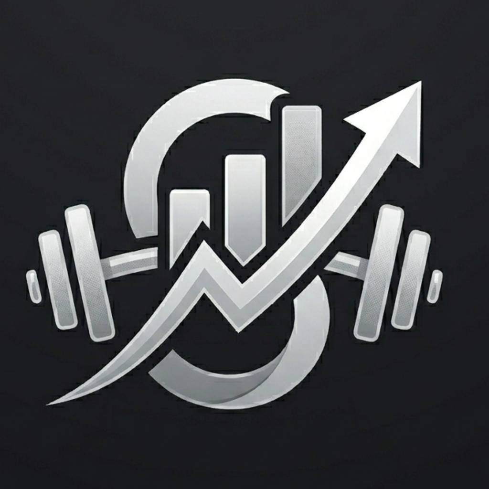
</p>

<h1 align="center">Shift — Fitness Tracker</h1>

<p align="center"><em>Strength. Endurance. One Shift.</em></p>

<p align="center">
  An offline-first fitness tracker for iPhone, iPad and Apple Watch.<br>
  Log gym workouts, record runs, walks and rides, and plan your training week.
</p>

<p align="center">
  
  
  
  
</p>

<p align="center"><a href="https://apps.apple.com/app/id6761838910">App Store</a> · <a href="https://shiftfitness.pro/">Website</a> · <a href="docs/privacy-policy.html">Privacy policy</a></p>

## Two ways to train

Switch between **Strength** and **Endurance** using the glass mode selector beside the Shift heading. Both modes share your account, profile, goals and training calendar. Violet and teal accents distinguish the modes in light and dark themes.

<p align="center">
  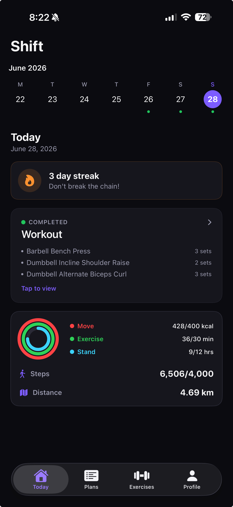
  &nbsp;
  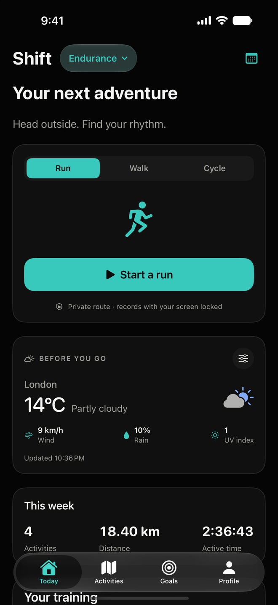
  &nbsp;
  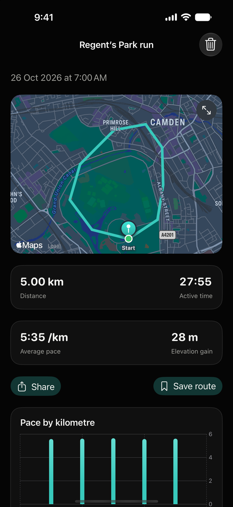
</p>

Screenshots of the Endurance release use the real native app with fictional demonstration data.

## Strength training

- Log weight, reps and RPE, with normal, warm-up and drop sets, supersets, exercise notes and mid-workout exercise changes.
- Use rest timers, lock-screen Live Activities, plate loading and previous-session results while you train.
- Create plans with exercise ordering, set counts, rep ranges, rest periods and weight targets, or choose a ready-made template.
- Browse exercise instructions, muscle targets and equipment information; add custom exercises and track exercise goals and personal bests.
- Generate personalised strength plans on device with Apple Foundation Models on compatible Apple Intelligence devices (**Pro**).
- Share a workout summary when you finish.

## Run, walk and ride

Record outdoor running, walking and cycling with **Core Location and Apple Maps**. The preparation screen brings together a neighbourhood map, GPS readiness, optional local weather and the Start action.

Activities include distance, active time, average pace or cycling speed, elevation and kilometre splits where recorded data supports them. Pause and resume manually, continue recording with the screen locked, and recover a saved draft after an interruption. Pauses and GPS gaps appear as separate route segments.

Look back through your activity history, save routes from completed activities and share an activity summary with or without a map. Saved routes do not provide turn-by-turn navigation or road snapping. Swimming, automatic pause, social feeds and competitive segments are not included in this release.

### Goals, records and milestones

Set distance, active-time and activity-count targets by sport or across Endurance. The target-first goal editor includes presets, increment controls, units and timeframe choices. Follow personal bests and open milestone badges to see what you earned, when you earned it and the activity that crossed the threshold. Badges support interactive rotation and respect Reduce Motion.

<p align="center">
  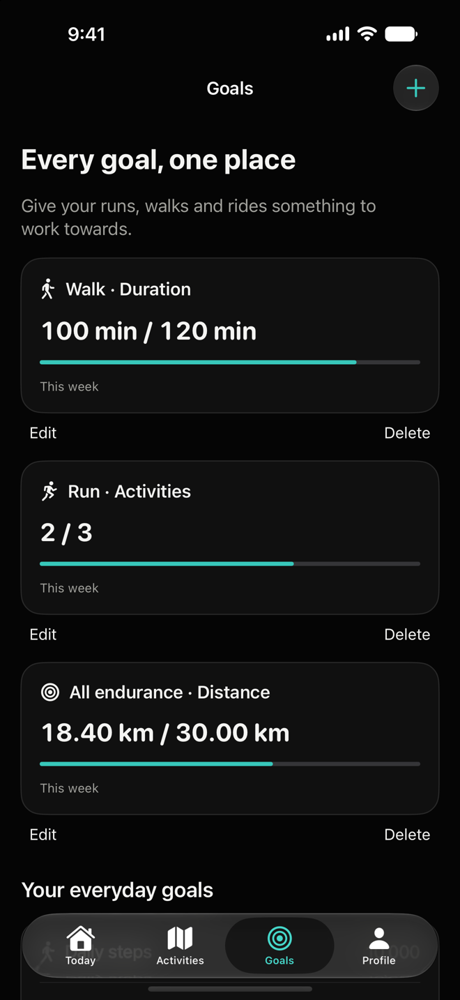
  &nbsp;
  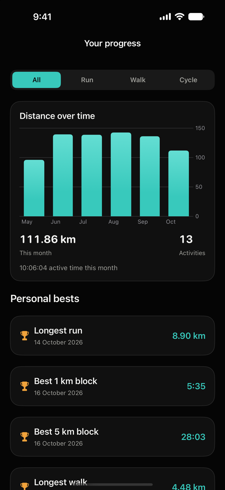
</p>

### Your training calendar

Strength appointments, endurance sessions and completed activities appear together. Schedule sessions, move or skip them, and start a planned workout from the calendar. Only explicitly saved appointments and completed activities appear; legacy weekly gym preferences do not create dated sessions automatically.

### Build your week

Choose a sport, frequency, session length and available time windows. Availability can differ each day. Shift suggests a week within those windows and can consider available hourly weather forecasts and optional Apple Calendar busy-time checks. Review the suggested sessions before saving them together.

- **One complete generated week is free per account.** Saving consumes the allowance; a failed save does not. The server records usage across devices and reinstalls.
- **Shift Pro** includes continued week planning, new training-plan library schedules and the on-device Endurance coach.
- The planner's manual controls work without Apple Intelligence. On supported devices, **Fill in my plan** can interpret a written goal and explicit availability.
- Calendar checking reads busy intervals on device. Shift does not modify Apple Calendar events or include event titles, locations or attendees in AI prompts or cloud sync.
- Missing forecasts and infeasible availability are explained. Saved sessions do not automatically move when the weather changes.

### Forecast change suggestions (2.1.1)

With **Shift Pro**, optionally enable **Watch for forecast changes** when saving a generated week. Existing or manually scheduled endurance sessions can opt in through their weather preferences after choosing availability and a duration. Shift compares later forecasts against the saved baseline and suggests a better time if conditions worsen.

Review the original time, changed conditions and proposed replacement, then choose **Move to this time** or **Keep original time**. Moves preserve the session's identity, duration and links; confirmation rechecks current weather, availability, other sessions and optional Apple Calendar busy times. Reminders, Watch agenda and widget summaries use the accepted time. No session moves automatically, and no unverified forecast is described as a better alternative.

<p align="center">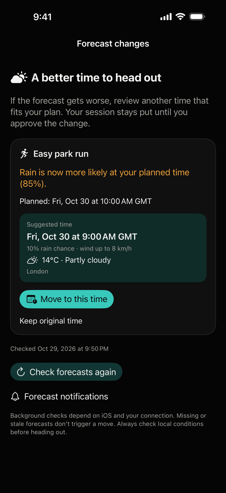</p>

Checks run on opening Shift and during opportunistic iOS background refresh. Optional forecast-change notifications are separate from ordinary reminders. Background checks are not guaranteed to run at a particular time. This feature is included in **2.1.1 (25)**, uploaded for the next App Store update. It is not in 2.1.0 (24). See [implementation and validation notes](docs/weather-rescheduling.md).

<p align="center">
  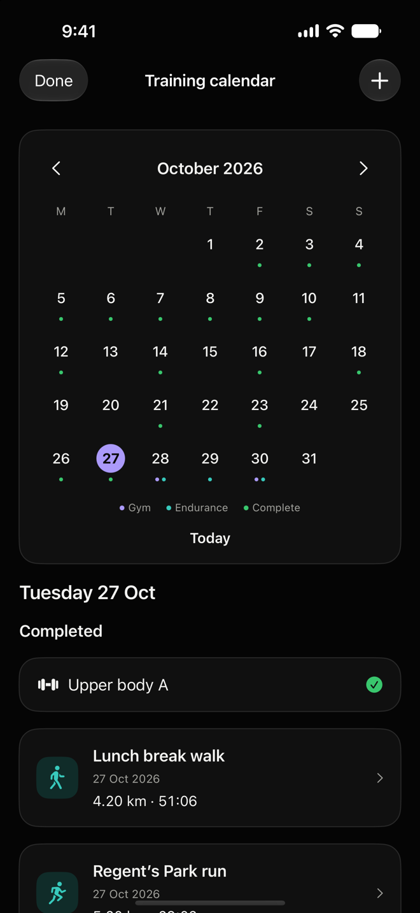
  &nbsp;
  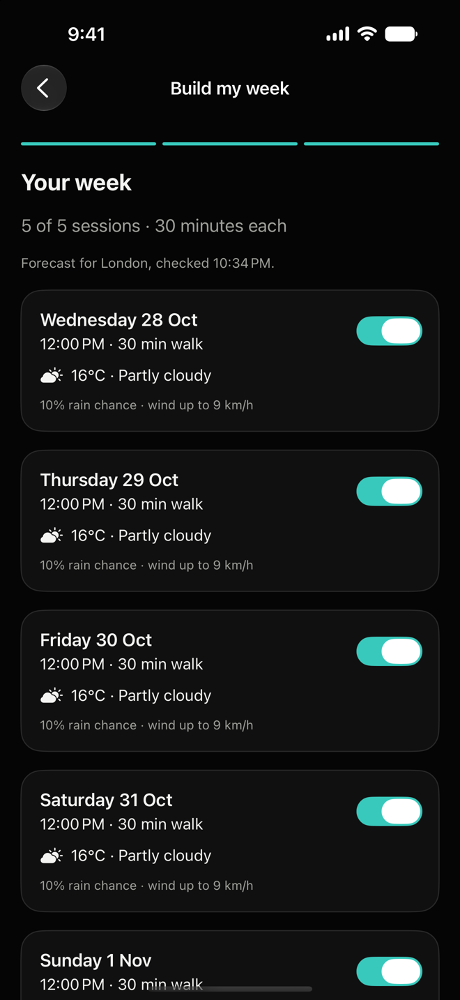
</p>

### Local weather

Opt in using a one-time location lookup or a city search. Current conditions, rounded temperatures, wind, rain, UV and linked provider warnings appear on Endurance home, activity preparation and weather settings. Apple Weather attribution and data-source links are retained. Weather is optional and separate from GPS recording.

### Apple Health

Import recorded running, walking, hiking and cycling workouts, including indoor workouts. **All history** is the default, with no lower date bound or result limit; Last year and Last 90 days are optional filters. A separate opt-in requests available workout routes.

Imports use stable, account-scoped Health workout identities to prevent duplicates. Reimporting can add a missing map without duplicating the workout. Missing route data does not block workout details, and the report distinguishes new activities, existing records and unavailable maps. Imports are manual; daily steps and walking-distance aggregates without a recorded workout are not turned into sessions.

Existing Health integration also supports steps, active energy, exercise minutes, stand hours, optional workout and body-weight writes, and counting workouts from other apps. Access depends on the permissions you grant and the data available in Apple Health.

## Profile and progress

A shared profile groups your weekly overview, goals, body journal and records. Log body weight, follow trends and set a target. Pro adds body measurements and progress photos with before/after comparison and Face ID protection. The six-month Endurance distance chart is also included with Pro.

## Apple Watch

The Pro companion supports gym logging, rest timers, daily steps, summaries and two-way WatchConnectivity sync. Endurance adds run, walk and cycle recording with a HealthKit workout session, GPS route samples, heart rate, distance and pace or speed.

Watch recordings are saved locally and queued for transfer to the paired iPhone when it is reachable. The Watch also shows upcoming training and a recent weather summary supplied by iPhone. Watch complications include Endurance weekly progress and quick access alongside existing workout and step views.

## Widgets and Live Activities

All home-screen widgets and Watch complications are included with Pro.

| Widget | What it shows |
| --- | --- |
| Today's Activity | Steps, workouts and streak |
| Streak Counter | Current training streak |
| Step Counter | Daily step progress |
| Weekly Progress | Gym sessions completed against your goal |
| Quick Start | A shortcut into a gym workout |
| Endurance this week | Distance, activities, active time, goal progress and run/walk/ride shortcuts; medium widgets can show recent weather |
| Up next in Shift | Upcoming Strength and Endurance appointments |

Endurance supports small, medium and rectangular accessory widgets. Rest timers retain their lock-screen Live Activity. Widget timelines and Watch summaries use private shared snapshots; they do not independently request WeatherKit.

<p align="center">
  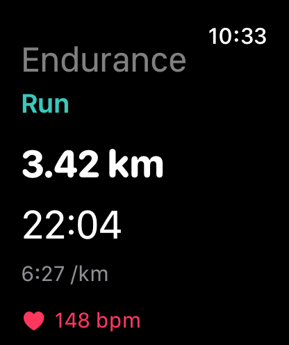
  &nbsp;&nbsp;
  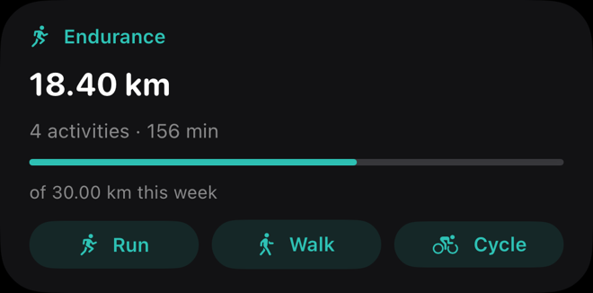
</p>

## Notifications

Choose training reminders **15, 30 or 60 minutes** before scheduled sessions. Reminders are rebuilt when sessions, settings or account data change, and started, completed, skipped or deleted sessions are excluded. Notification links open the relevant calendar date or Endurance view.

Optional Endurance achievement alerts celebrate newly recorded personal bests, milestones and reached goals. Historical Health imports do not trigger retrospective celebrations, and the event ledger prevents repeated alerts. Existing exercise, weekly workout, daily step, rest-completion and inactive-workout notifications remain available. Delivery requires notification permission and follows the device's notification settings.

## Free and Shift Pro

One optional monthly or yearly subscription covers both training modes. Existing saved sessions remain accessible after the free week is used or a subscription ends.

| Feature | Free | Shift Pro |
| --- | --- | --- |
| Gym workout tracking, exercise library and custom exercises | Yes | Yes |
| Weight tracking and graphs | Yes | Yes |
| Gym plans | Up to 3 | Unlimited |
| Run, walk and cycle recording, maps and activity history | Yes | Yes |
| Apple Health workout imports | Yes | Yes |
| Basic Endurance goals, personal bests and milestones | Yes | Yes |
| Current weather, manual scheduling and reminders | Yes | Yes |
| Forecast monitoring and confirmed reschedule suggestions (2.1.1) | — | Yes |
| Complete generated endurance week with optional weather/Calendar checks | One saved week per account | Continued planning |
| On-device Endurance coach | — | Yes, on supported devices |
| New endurance training-plan schedules and six-month trends | — | Yes |
| AI strength plan tools | — | Yes, on supported devices |
| Progress photos and body measurements | — | Yes |
| Apple Watch, widgets and complications | — | Yes |

AI features require iOS 26 or later, compatible hardware and Apple Intelligence enabled. Core iPhone features support iOS 17+, and the Watch companion supports watchOS 10+.

## Development

Open `Shift.xcodeproj` in a current Xcode with the required iOS and watchOS SDKs. Swift Package Manager resolves the checked-in package versions. Select the **Shift** scheme to build the iPhone app and its embedded Watch/widget targets. Physical-device runs require your development team, provisioning and matching app-group/capability configuration.

```sh
xcodebuild -project Shift.xcodeproj -scheme Shift \
  -configuration Debug -destination 'generic/platform=iOS Simulator' \
  CODE_SIGNING_ALLOWED=NO build
```

### Architecture

```text
Shared/                    Shared activity, planning, entitlement and Watch transfer models
Shift/
  App/                     Entry point, app intents and navigation
  Views/Endurance/         Recording, history, goals, weather, coach and planner
  Views/                   Strength, profile, progress, settings and authentication
  Services/                Recording, Health, weather, Calendar, planning, sync and notifications
  Repositories/            GRDB persistence and account-scoped stores
  Database/                Local schema and migrations
  Development/             Simulator-only fictional capture fixtures
  Components/              Shared controls and training-mode header
  Connectivity/            Phone side of WatchConnectivity
  Theme/                   Light/dark colours and design tokens
ShiftWatch/                Watch companion and local recording outbox
ShiftTimerWidget/          iPhone widgets and rest-timer Live Activity
ShiftWatchComplications/   Watch face complications
supabase/migrations/       PostgreSQL schema, validation, RLS and preview-save RPC
ShiftTests/                Unit and integration test sources
```

| Area | Technology |
| --- | --- |
| Interface | SwiftUI and Observation |
| Local data | GRDB / SQLite |
| Authentication and private sync | Supabase with row-level security |
| Recording and maps | Core Location, MapKit and HealthKit |
| Weather | WeatherKit |
| Calendar busy-time checks | EventKit |
| Subscriptions | StoreKit 2 |
| Watch transfer | WatchConnectivity |
| Widgets and Live Activities | WidgetKit and ActivityKit |
| On-device AI | Apple Foundation Models |

Local SQLite records are the source of truth for tracking. Pending changes use the existing mutation queue for later Supabase sync. Recording and saved history remain usable offline; maps may need downloaded tiles or a connection. Weather, account services, cloud sync and the server-claimed free generated week require connectivity.

Endurance adds migrations **027–029** for activities/goals, training sessions/saved routes and the one-week preview receipt/RPC. See the [release notes](docs/endurance-v5.md) for access rules and deployment details. Health, location, Calendar and notifications are optional and requested for the features that need them. Account deletion and data export include Endurance records.

### Validation

`ShiftTests` includes tracking geometry, pause/recovery, account isolation, imports, milestones, time parsing, scheduling, reminders and Pro/free-week tests. PostgreSQL integration scripts run against disposable in-memory PGlite databases and do not connect to production:

```sh
# Install the test dependency outside the app repository.
npm install --prefix /tmp/shift-schema-tools @electric-sql/pglite
export PGLITE_MODULE_PATH=/tmp/shift-schema-tools/node_modules/@electric-sql/pglite/dist/index.js
node scripts/test-endurance-schema.mjs
node scripts/test-training-schema.mjs
node scripts/test-endurance-preview-schema.mjs
```

Release notes record the checks and device-testing limits for each build. Simulator builds and native model tests do not establish real GPS accuracy, Health/Calendar permissions, notification delivery or Watch behaviour on hardware.

### Demo captures

Store and promo fixtures are compiled only with `SHIFT_STORE_CAPTURE` **and** a simulator target, then activated with `--store-capture`. They use fictional local data and an unreachable backend endpoint. Normal Debug/Release builds exclude this capture code. Generated artwork, review recordings, archives and video exports remain local and are ignored by Git.

The [iPad and Watch artwork workflow](docs/store-device-artwork.md) documents native device captures, the nine-image iPad set, four Watch screens and their reproducible renderer. New listing images are reviewed before upload.

## Release notes

Version **2.1.0 (24)** contains the Endurance release and was verified **Ready for Distribution** on 29 October 2026. Version **2.1.1 (25)** adds forecast-change suggestions and was uploaded on the same date. It is **Waiting for Review**, with automatic release after approval selected; see the [2.1.1 release record](docs/release-2.1.1.md).

- [Endurance recording and initial release](docs/endurance-release.md)
- [Calendar, routes, records, Watch, widgets and notifications](docs/endurance-v2.md)
- [Weather, coach, full-history imports and profile](docs/endurance-v3.md)
- [Goal editors, interactive badges, planner and Calendar polish](docs/endurance-v4.md)
- [Pro split and one complete free generated week](docs/endurance-v5.md)

## License

This project is proprietary. All rights reserved. Exercise catalogue licensing and attribution are documented in [the catalogue migration notes](docs/repdb-migration.md).
